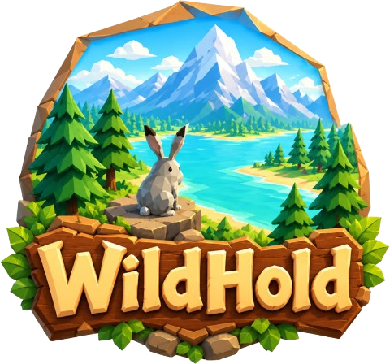

# WildHold

Jeu de survie low-poly : récolte, construction, villages, grottes, donjons, volcans, camps orcs, monstres la nuit, seul ou entre amis.
Développé par **SnkAlex** (version alpha, réservée aux testeurs).

## Télécharger
Va dans **[Releases](https://github.com/SnkStudio/WildHold/releases/latest)** et télécharge `Installer.WildHold.x.y.exe`.

- Windows peut afficher « Windows a protégé votre ordinateur » : clique sur **Informations complémentaires** puis **Exécuter quand même**.
- Autorise WildHold sur le réseau si Windows le demande (multijoueur).

## Mises à jour
Le jeu vérifie tout seul au lancement s'il existe une nouvelle version : clique sur **Installer la mise à jour** dans le menu principal.
Tes mondes ne sont jamais touchés.

Ce dépôt contient seulement les versions du jeu.
